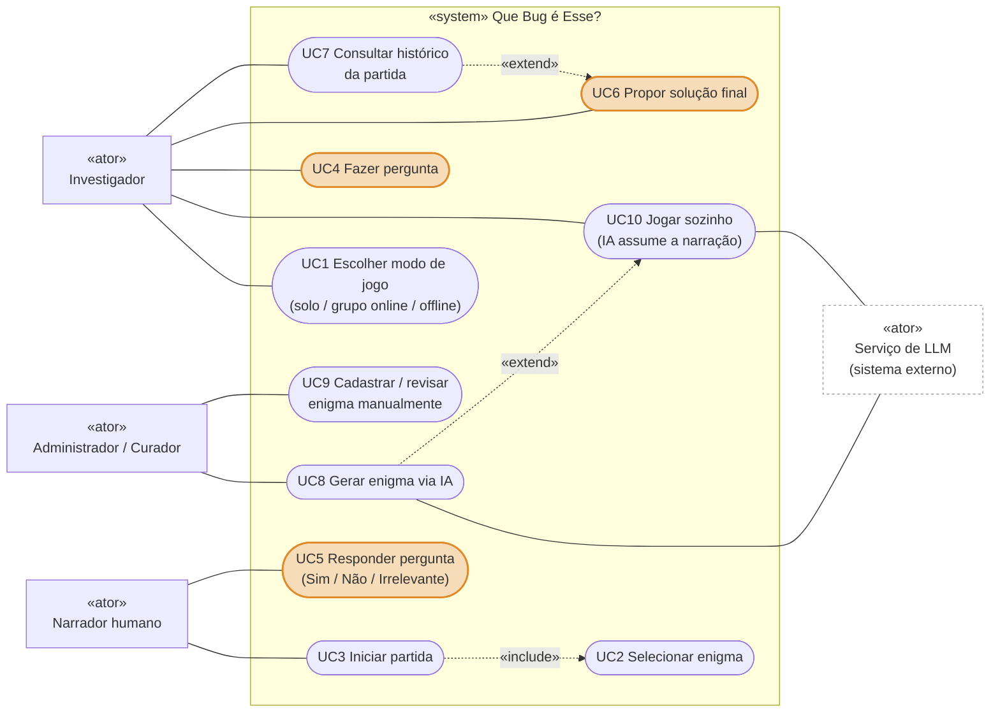

# Diagrama de casos de uso

| Campo | Valor |
|---|---|
| Fonte original | [`diagramas/diagrama_casos.pdf`](../../diagramas/diagrama_casos.pdf), versão de 14/10/2026 |
| Estado | Transcrição fiel do PDF. As mudanças já decididas nas specs e ADRs estão em [Pendências por diagrama](README.md#pendências-por-diagrama) |

## Notas do PDF

- "No modo solo, UC5 é executado pelo NarradorIA — mesmo caso de uso, outra implementação do port Narrador."
- "Destaque laranja = fluxo principal da investigação (UC4 → UC5 → UC6)."
- "«include» parte do caso base (sempre executa). «extend» parte do caso opcional para o caso que ele estende."

Legenda do PDF: boneco = ator (contorno claro = sistema externo) · elipse = caso de uso · elipse laranja = fluxo principal · linha cheia = associação · tracejada = «include» / «extend» · retângulo = fronteira do sistema.
