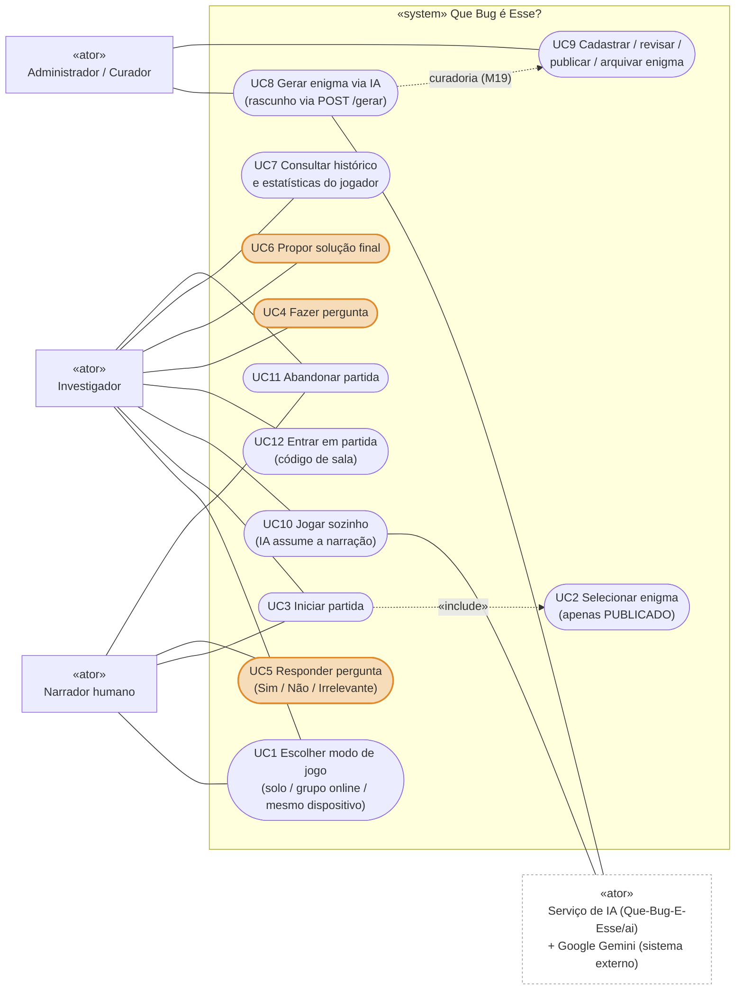

# Diagrama de casos de uso

| Campo | Valor |
|---|---|
| Fonte original | [`diagramas/diagrama_casos.pdf`](../../diagramas/diagrama_casos.pdf), versão de 14/10/2026 |
| Estado | Atualizado em 2026-11-24 com S00–S10, ADRs 0001–0009, M10–M24 e marco M4 (S11 e S12) |

## Notas atualizadas (P9)

- **UC1 (ADR 0006 A, M14):** o modo "offline" passa a ser "mesmo dispositivo" (grupo reunido num único terminal ou tela, entregue pela CLI local da S05).
- **UC3 (M12):** no modo solo, o próprio investigador inicia a partida; no modo grupo, o narrador humano cria a sala e inicia a partida após a entrada dos investigadores (UC12, M11).
- **UC5 e UC6 no solo (ADR 0001 A, ADR 0002 A):** no modo solo, a resposta é disparada pelo ouvinte `AoFazerPerguntaNoSolo` chamando o caso de uso `ResponderComIA` (porta `Narrador`, síncrona, só IA) e o veredito pelo ouvinte `AoProporSolucaoNoSolo` chamando `AvaliarComIA` (porta `VerificadorDeSolucao`, só solo). No grupo, o narrador humano chama `ResponderPergunta` e `JulgarProposta` diretamente.
- **UC7 (M13, M17, S12):** removida a relação `«extend»` entre UC7 e UC6; UC7 associa-se diretamente ao Investigador e combina o histórico (`GET /api/historico`, sem `solucaoCompleta`) com as estatísticas atualizadas pelo ouvinte `AoEncerrarPartidaAtualizarEstatisticas` (`GET /api/perfil`).
- **UC8 e UC9 (M19, S11):** removida a relação `UC8 -.-> «extend» UC10` do PDF original. Todo enigma gerado por IA (`POST /gerar` via `GeradorDeEnigmasHttp`) ou cadastrado manualmente nasce em `RASCUNHO` e passa pela curadoria (`/api/curadoria/enigmas/*`: revisar, publicar, arquivar) antes de ficar disponível em `GET /api/enigmas` e em UC2.
- **UC11 (M10, H2):** o narrador pode abandonar em qualquer modo; o investigador só pode abandonar no modo `SOLO`.
- **UC12 (M11, ADR 0007 A):** entrada de investigadores em sala de espera no modo grupo online via código de convite e token de convidado (S06).
- Destaque laranja = fluxo principal da investigação (UC4 → UC5 → UC6).

Legenda do PDF: boneco = ator (contorno claro = sistema externo) · elipse = caso de uso · elipse laranja = fluxo principal · linha cheia = associação · tracejada = «include» / «extend» · retângulo = fronteira do sistema.
