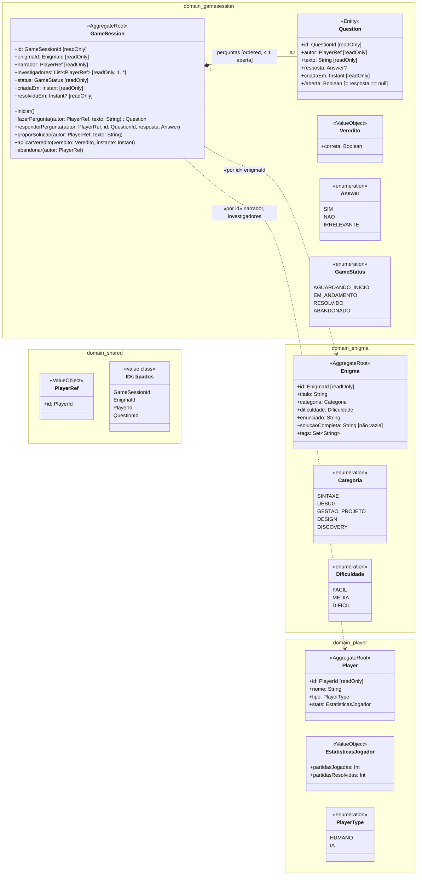

# Diagrama de classes do domínio

| Campo | Valor |
|---|---|
| Fonte original | [`diagramas/diagrama_classes.pdf`](../../diagramas/diagrama_classes.pdf), versão de 14/10/2026 |
| Estado | Transcrição fiel do PDF. As mudanças já decididas nas specs e ADRs estão em [Pendências por diagrama](README.md#pendências-por-diagrama) |

## Notas do PDF

- "Toda mutação passa pela raiz: status e perguntas só mudam pelos métodos (private set / lista privada)."
- "~ solucaoCompleta: visível só no pacote domain — nunca vai para a tela durante a investigação."
- "Tipos de valor (VO, enum, IDs) aparecem só como tipo de atributo: as linhas ficam reservadas para composição e referência entre agregados."

Notação do PDF:

| Notação | Leitura |
|---|---|
| `+` / `-` / `~` | público / privado / interno ao pacote |
| `{readOnly}` (aqui `[readOnly]`) | Kotlin `val` (ou `var` com `private set`) |
| `Tipo?` · `/nome` | anulável (Kotlin) · atributo derivado |
| ◆—— | composição: a parte só existe dentro da raiz |
| `- - -> «por id»` | referência a outro agregado apenas por ID |

Legenda do PDF: cabeçalho escuro = «AggregateRoot» · bege = «Entity» · claro = «ValueObject» / «enumeration» · pasta laranja = pacote · ◆ composição · tracejada = referência por ID.
