# Diagrama de classes do domínio

| Campo | Valor |
|---|---|
| Fonte original | [`diagramas/diagrama_classes.pdf`](../../diagramas/diagrama_classes.pdf), versão de 14/10/2026 |
| Estado | Atualizado em 2026-11-24 com S01–S04 (emendas 1 e 2 da S03), ADRs 0001–0002 e marco M4 (S11 e S12) |

```mermaid
classDiagram
    direction LR
    namespace domain_gamesession {
        class GameSession {
            <<AggregateRoot>>
            +id: GameSessionId [readOnly]
            +enigmaId: EnigmaId [readOnly]
            +modo: ModoDeJogo [readOnly]
            +narrador: PlayerRef [readOnly]
            +investigadores: List~PlayerRef~ [readOnly, H5]
            +status: GameStatus [readOnly]
            +/fase: FaseDaInvestigacao?
            +criadaEm: Instant [readOnly]
            +resolvidaEm: Instant? [readOnly]
            +criar(id, enigmaId, modo, narrador, investigadores, agora) GameSession
            +reconstituir(id, enigmaId, modo, narrador, investigadores, criadaEm, status, resolvidaEm, perguntas, tentativas) GameSession
            +iniciar(agora: Instant)
            +fazerPergunta(autor: PlayerRef, texto: String, agora: Instant) Question
            +responderPergunta(autor: PlayerRef, id: QuestionId, resposta: Answer, agora: Instant)
            +cancelarPergunta(autor: PlayerRef, id: QuestionId, agora: Instant)
            +proporSolucao(autor: PlayerRef, texto: String, agora: Instant) Tentativa
            +retirarProposta(autor: PlayerRef, agora: Instant)
            +aplicarVeredito(autor: PlayerRef, veredito: Veredito, agora: Instant)
            +abandonar(autor: PlayerRef, agora: Instant)
            +puxarEventos() List~EventoDePartida~
        }
        class Question {
            <<Entity>>
            +id: QuestionId [readOnly]
            +autor: PlayerRef [readOnly]
            +texto: String [readOnly]
            +resposta: Answer? [readOnly]
            +cancelada: Boolean [readOnly]
            +criadaEm: Instant [readOnly]
            +/aberta: Boolean [= resposta == null && !cancelada]
        }
        class Tentativa {
            <<Entity>>
            +id: TentativaId [readOnly]
            +autor: PlayerRef [readOnly]
            +texto: String [readOnly]
            +criadaEm: Instant [readOnly]
            +situacao: SituacaoTentativa [readOnly]
        }
        class Veredito {
            <<ValueObject>>
            +correta: Boolean
        }
        class ModoDeJogo {
            <<enumeration>>
            SOLO
            GRUPO
        }
        class FaseDaInvestigacao {
            <<enumeration>>
            AGUARDANDO_PERGUNTA
            PERGUNTA_PENDENTE
            SOLUCAO_EM_AVALIACAO
        }
        class SituacaoTentativa {
            <<enumeration>>
            PENDENTE
            CORRETA
            INCORRETA
            RETIRADA
        }
        class Answer {
            <<enumeration>>
            SIM
            NAO
            IRRELEVANTE
        }
        class GameStatus {
            <<enumeration>>
            AGUARDANDO_INICIO
            EM_ANDAMENTO
            RESOLVIDO
            ABANDONADO
        }
        class EventoDePartida {
            <<sealed interface>>
            +partidaId: GameSessionId
            +ocorridoEm: Instant
            PartidaIniciada
            PerguntaFeita
            PerguntaRespondida
            PerguntaCancelada
            SolucaoProposta
            PropostaRetirada
            SolucaoRecusada
            PartidaResolvida
            PartidaAbandonada
        }
    }
    namespace domain_enigma {
        class Enigma {
            <<AggregateRoot>>
            +id: EnigmaId [readOnly]
            +conteudo: ConteudoEnigma [readOnly]
            +origem: OrigemEnigma [readOnly]
            +status: StatusEnigma [readOnly]
            +criar(id, conteudo, origem) Enigma
            +reconstituir(id, conteudo, origem, status) Enigma
            +revisar(novo: ConteudoEnigma)
            +publicar()
            +arquivar()
        }
        class ConteudoEnigma {
            <<ValueObject>>
            +titulo: String [1..100]
            +categoria: Categoria
            +dificuldade: Dificuldade
            +enunciado: String [1..2000]
            +solucaoCompleta: String [1..2000, omitida no toString]
            +tags: Set~String~
        }
        class CriterioDeSelecao {
            <<ValueObject>>
            +categoria: Categoria?
            +dificuldade: Dificuldade?
            +elegiveis(candidatos: List~Enigma~, jaJogados: Set~EnigmaId~) List~Enigma~
        }
        class StatusEnigma {
            <<enumeration>>
            RASCUNHO
            PUBLICADO
            ARQUIVADO
        }
        class OrigemEnigma {
            <<enumeration>>
            MANUAL
            IA
        }
        class Categoria {
            <<enumeration>>
            SINTAXE
            DEBUG
            GESTAO_PROJETO
            DESIGN
            DISCOVERY
        }
        class Dificuldade {
            <<enumeration>>
            FACIL
            MEDIA
            DIFICIL
        }
    }
    namespace domain_player {
        class Player {
            <<AggregateRoot>>
            +id: PlayerId [readOnly]
            +nome: String [readOnly, 1..40]
            +tipo: PlayerType [readOnly]
            +stats: EstatisticasJogador [readOnly]
            +criar(id, nome, tipo) Player
            +reconstituir(id, nome, tipo, stats) Player
            +registrarPartidaResolvida() Player
            +registrarPartidaAbandonada() Player
        }
        class EstatisticasJogador {
            <<ValueObject>>
            +partidasJogadas: Int
            +partidasResolvidas: Int [0 <= resolvidas <= jogadas]
            +registrarPartidaResolvida() EstatisticasJogador
            +registrarPartidaAbandonada() EstatisticasJogador
        }
        class PlayerType {
            <<enumeration>>
            HUMANO
            IA
        }
    }
    namespace domain_shared {
        class DomainEvent {
            <<interface>>
            +ocorridoEm: Instant
        }
        class PlayerRef {
            <<ValueObject>>
            +id: PlayerId
        }
        class IDsTipados["IDs tipados"] {
            <<value class>>
            GameSessionId [UUID]
            EnigmaId [UUID]
            PlayerId [UUID]
            QuestionId [Int >= 1]
            TentativaId [Int >= 1]
        }
    }

    GameSession "1" *-- "0..*" Question : perguntas [ordered, <= 1 aberta]
    GameSession "1" *-- "0..*" Tentativa : tentativas [ordered, <= 1 pendente]
    Enigma "1" *-- "1" ConteudoEnigma : conteudo
    EventoDePartida ..|> DomainEvent
    GameSession ..> Enigma : «por id» enigmaId
    GameSession ..> Player : «por id» narrador, investigadores
```

## Notas atualizadas (P9)

- **Domínio puro (P1):** todo comando que registra instante recebe `agora: Instant`; IDs entram prontos de fora (`QuestionId` e `TentativaId` numerados a partir de 1 por partida).
- **Mutação só pela raiz (P2):** `status`, `resolvidaEm`, `perguntas` e `tentativas` só mudam pelos métodos de `GameSession` (`private set` e cópias defensivas em `List` somente leitura). `GameSession.reconstituir(...)` valida I1–I8 e inicia sem eventos pendentes (S03 emenda 2).
- **Sigilo por papel (P3, M1, M21):** Kotlin não possui visibilidade de pacote (`~`). `solucaoCompleta` é `val` pública em `ConteudoEnigma` (omitida em `toString()` de `ConteudoEnigma` e `Enigma`); o controle de visibilidade acontece na camada de aplicação por meio de `VisaoInvestigador` (sem solução até estado terminal) e `VisaoNarrador` (com solução).
- **H5 estendida (S01):** narrador não pode figurar em `investigadores`, sem investigadores duplicados, ao menos 1 investigador no `GRUPO` e exatamente 1 no `SOLO`.
- **Autoria do veredito (ADR 0001 A, S03 emenda 1):** `aplicarVeredito(autor, veredito, agora)` exige `autor == narrador` (narrador humano no grupo; jogador IA no solo).
- **Curadoria e geração de enigmas (S11, M19):** `Enigma` nasce sempre em `RASCUNHO` (`MANUAL` ou `IA`), aceita `revisar` apenas em `RASCUNHO`, transita `RASCUNHO -> PUBLICADO` ou `RASCUNHO / PUBLICADO -> ARQUIVADO`; a porta `GeradorDeEnigmas` e o valor `EnigmaGerado` residem em `domain.enigma.port`.
- **Atualização de estatísticas em `Player` (S12, M17):** `Player` e `EstatisticasJogador` expõem os métodos puros `registrarPartidaResolvida()` e `registrarPartidaAbandonada()`, preservando imutabilidade e a invariante `0 <= partidasResolvidas <= partidasJogadas`; acionados pelo ouvinte `AoEncerrarPartidaAtualizarEstatisticas` em `PartidaResolvida` e `PartidaAbandonada`.

Notação:

| Notação | Leitura |
|---|---|
| `+` / `-` | público / privado |
| `[readOnly]` | Kotlin `val` (ou `var` com `private set`) |
| `Tipo?` · `/nome` | anulável (Kotlin) · atributo derivado |
| `*--` | composição: a parte só existe dentro da raiz |
| `..> «por id»` | referência a outro agregado apenas por ID |
