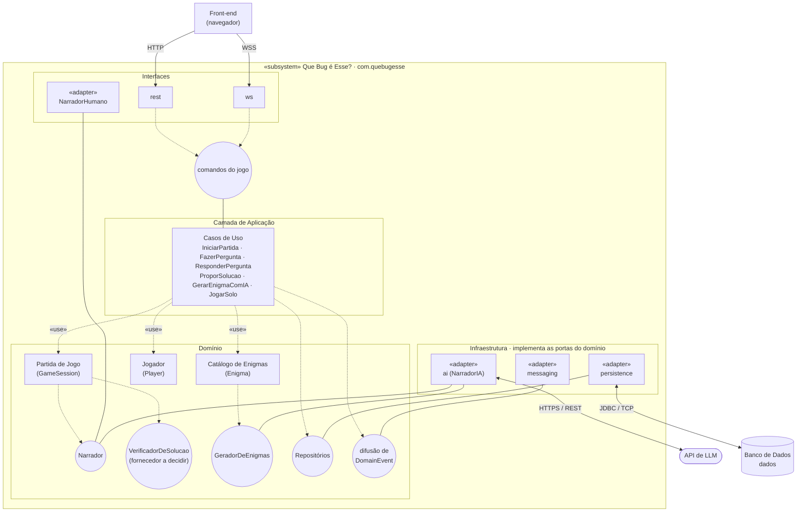

# Diagrama de componentes

| Campo | Valor |
|---|---|
| Fonte original | [`diagramas/Diagrama_comp.pdf`](../../diagramas/Diagrama_comp.pdf), versão de 14/10/2026 |
| Estado | Transcrição fiel do PDF. As mudanças já decididas nas specs e ADRs estão em [Pendências por diagrama](README.md#pendências-por-diagrama) |

Círculo ligado por linha cheia = interface fornecida; seta tracejada até o círculo = interface requerida.

## Notas do PDF

- "NarradorHumano só repassa a resposta digitada pelo narrador humano."
- "A tela recebe só enunciado e estado público: solucaoCompleta não sai do domínio."
- "Adaptadores trocáveis sem tocar no domínio."

Legenda do PDF: ▭ com ícone = componente · contorno laranja = camada · ○ ligado por linha cheia = interface fornecida · seta tracejada até ○ = interface requerida · tracejada «use» = dependência · seta cheia = protocolo de acesso.
