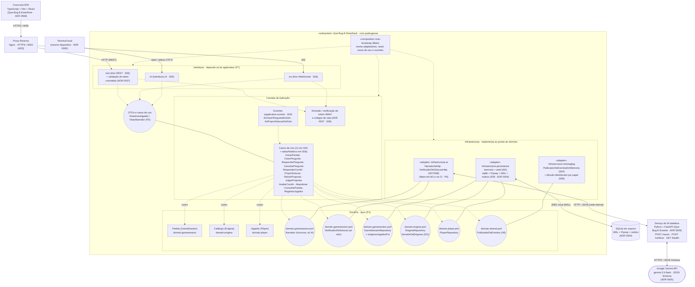

# Diagrama de componentes

| Campo | Valor |
|---|---|
| Fonte original | [`diagramas/Diagrama_comp.pdf`](../../diagramas/Diagrama_comp.pdf), versão de 14/10/2026 |
| Estado | Atualizado em 2026-11-24 com S00–S05, ADRs 0001–0009 (M1 concluído; S06–S09 especificadas) |

Círculo ligado por linha cheia = interface fornecida; seta tracejada até o círculo = interface requerida.

## Notas atualizadas (P9)

- **Sem `NarradorHumano` (ADR 0002 A, M2):** o adaptador `NarradorHumano` foi removido da camada `interfaces`. No modo grupo, o narrador humano envia comandos diretamente para `ResponderPergunta` e `JulgarProposta`. A porta `Narrador` é síncrona e usada apenas pela IA no modo solo (`ResponderComIA`).
- **`VerificadorDeSolucao` só no solo (ADR 0001 A):** removido "(fornecedor a decidir)". No modo solo, `AvaliarComIA` chama `VerificadorDeSolucao` via `VerificadorDeSolucaoHttp`; no grupo, o narrador humano julga via `JulgarProposta`.
- **Sigilo da solução por papel (P3, M1):** substituída a nota antiga "solucaoCompleta não sai do domínio". A aplicação monta `VisaoInvestigador` (sem solução até estado terminal) e `VisaoNarrador` (com solução apenas para o narrador autenticado da partida).
- **Três repositórios (ADR 0009 A, M23):** `Que-Bug-E-Esse/front` acessa exclusivamente `Que-Bug-E-Esse/back` (via proxy HTTPS/WSS em produção ou direto ao Ktor em desenvolvimento), nunca o serviço `Que-Bug-E-Esse/ai` nem o banco.
- **Raiz de composição (M16, S05 D4):** o módulo `bootstrap` é o único que conhece todas as camadas e conecta adaptadores às portas.
- **Portas e eventos (S02–S04):** portas agrupadas em `domain.<agregado>.port` e `domain.shared.port` (`PublicadorDeEventos`); eventos saem apenas depois de `salvar` (H6).

Legenda: ▭ = componente · ○ ligado por linha cheia = interface fornecida · seta tracejada até ○ = interface requerida · tracejada «use» = dependência · seta cheia = protocolo de acesso.
