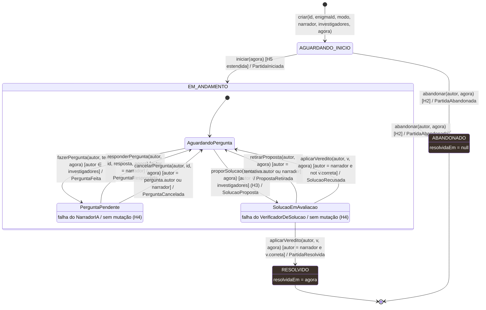

# Diagrama de estados da partida

| Campo | Valor |
|---|---|
| Fonte original | [`diagramas/diagrama_estados.pdf`](../../diagramas/diagrama_estados.pdf), versão de 14/10/2026 |
| Estado | Atualizado em 2026-11-24 com S01, S03 (emenda 1, ADR 0001 A) e S04 (H6) |

## Regras da partida

| Regra | Texto |
|---|---|
| H1 | Estados terminais (`RESOLVIDO`, `ABANDONADO`) não aceitam novos comandos |
| H2 | Só participante autorizado pode abandonar: narrador sempre; investigador apenas no modo `SOLO` (S01 Q1, M10) |
| H3 | Proposta de solução só sem pergunta em aberto |
| H4 | Falha da IA (`Narrador` ou `VerificadorDeSolucao`) não muda o estado da partida; a pergunta segue pendente ou a tentativa segue em avaliação para retentativa, cancelamento ou retirada |
| H5 | H5 estendida (S01 Q5): narrador definido, ao menos 1 investigador, narrador fora dos investigadores, sem investigadores repetidos e exatamente 1 investigador no modo `SOLO` |
| H6 | Eventos de domínio são publicados apenas após persistência confirmada (`salvar` → `puxarEventos()` → `publicar`; S04, M9; outbox transacional na S09) |
| H8 | Toda proposta fica registrada como entidade `Tentativa` com situação (`PENDENTE`, `CORRETA`, `INCORRETA`, `RETIRADA`) |
| R3 | Comando rejeitado não provoca mutação parcial e não gera evento de domínio (P2) |

## Notas atualizadas (P9)

- **Tempo explícito (P1, S01 D1):** todos os comandos recebem `agora: Instant`.
- **Destravamento (M3, S01 D4):** `cancelarPergunta` e `retirarProposta` retornam à fase `AguardandoPergunta`, autorizados apenas para o autor do item ou para o narrador (R5).
- **Guarda de autoria no veredito (ADR 0001 A, S03 emenda 1):** `aplicarVeredito(autor, veredito, agora)` exige `autor = narrador` (narrador humano no grupo; jogador IA no solo).
- **Uma pergunta aberta e uma proposta pendente por vez (I1–I3):** pergunta aberta e tentativa pendente nunca coexistem; a fase (`FaseDaInvestigacao?`) existe se e somente se `status == EM_ANDAMENTO`.

Legenda: ● estado inicial · ◉ estado final · cantos arredondados = estado · fundo escuro = estado terminal · seta = transição `comando(args) [guarda] / evento de domínio`.
