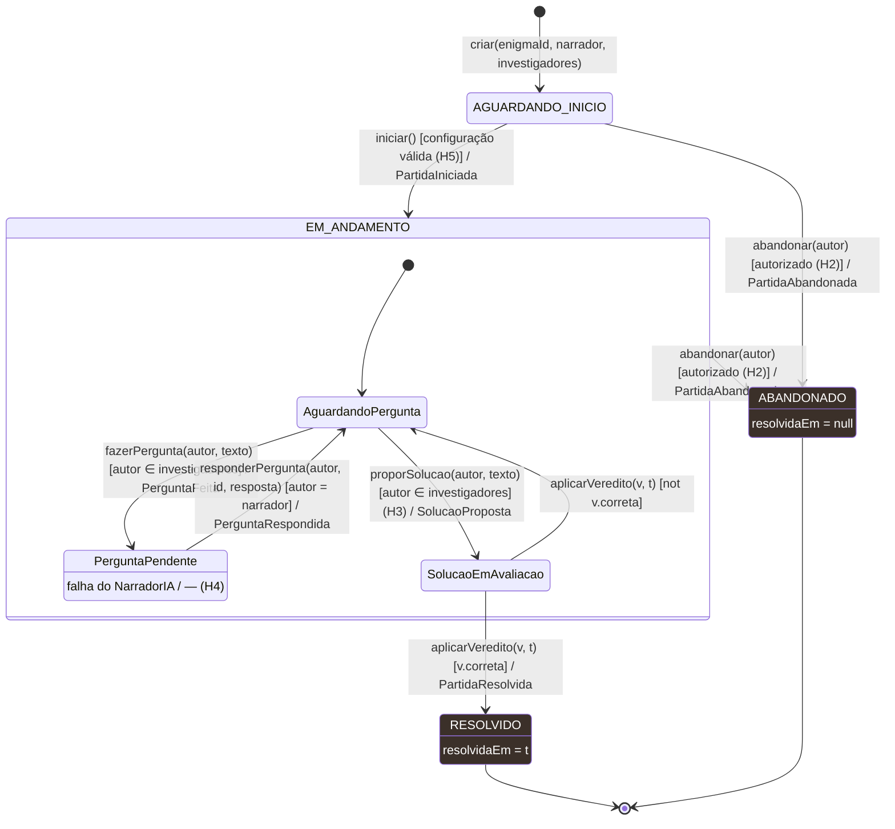

# Diagrama de estados da partida

| Campo | Valor |
|---|---|
| Fonte original | [`diagramas/diagrama_estados.pdf`](../../diagramas/diagrama_estados.pdf), versão de 14/10/2026 |
| Estado | Transcrição fiel do PDF. As mudanças já decididas nas specs e ADRs estão em [Pendências por diagrama](README.md#pendências-por-diagrama) |

## Regras da partida (quadro do PDF)

| Regra | Texto |
|---|---|
| H1 | Estados terminais não aceitam novos comandos |
| H2 | Só participante autorizado pode abandonar |
| H3 | Proposta só sem pergunta em aberto |
| H4 | Falha da IA não muda estado; a pergunta segue pendente |
| H5 | Narrador definido e ao menos 1 investigador |

## Notas do PDF

- "Uma única pergunta em aberto por vez: a invariante vira estrutura do diagrama, não só uma guarda."
- "Toda transição com guarda falsa é rejeitada sem alterar o estado. Rótulos: evento(args) [guarda] / evento de domínio."
- "H1 — terminais rejeitam perguntas, propostas e novo abandono."

Legenda do PDF: ● estado inicial · ◉ estado final · cantos arredondados = estado · fundo escuro = estado terminal · contorno laranja = estado composto · seta = transição evento [guarda] / efeito.
