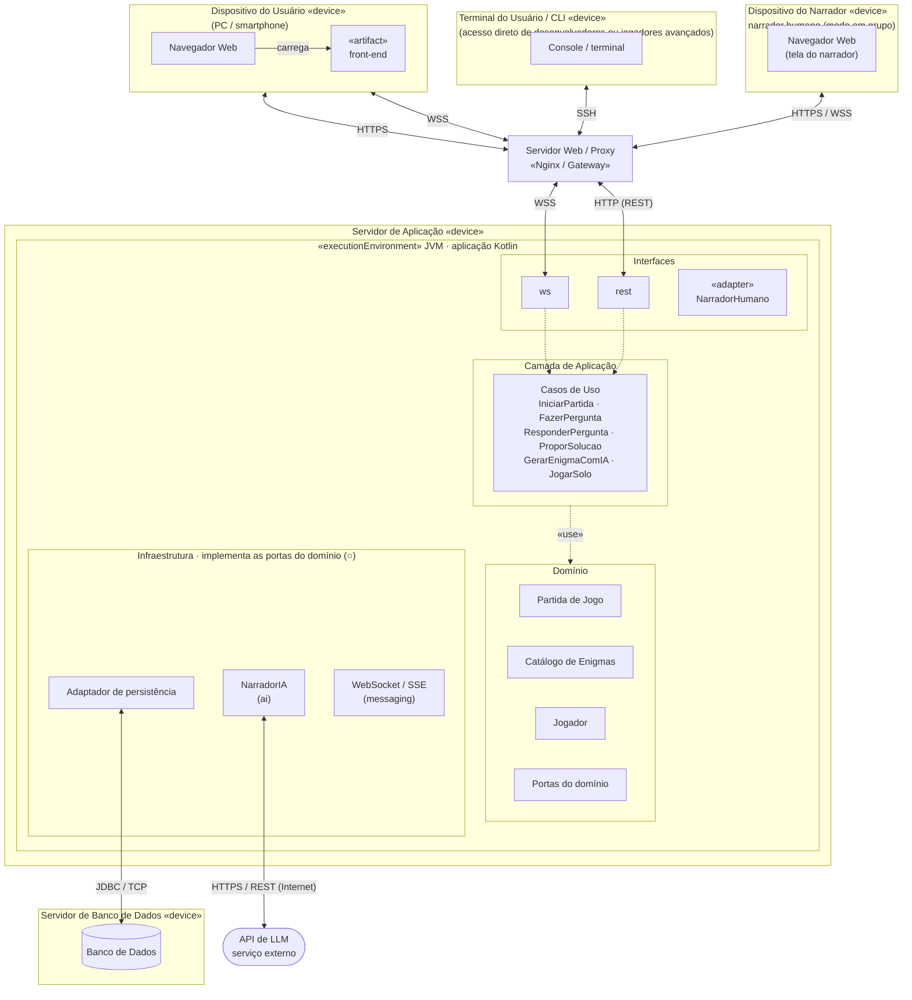

# Diagrama de implantação

| Campo | Valor |
|---|---|
| Fonte original | [`diagramas/Diagrama_imp.pdf`](../../diagramas/Diagrama_imp.pdf), versão de 14/10/2026 |
| Estado | Transcrição fiel do PDF. As mudanças já decididas nas specs e ADRs estão em [Pendências por diagrama](README.md#pendências-por-diagrama) |

## Notas do PDF

- "Cliente SSH: jogar via terminal — útil para validar o fluxo manualmente durante o TDD."
- "O NarradorHumano roda no servidor: só repassa a resposta que o narrador digita aqui."
- "Adaptadores trocáveis sem tocar no domínio."
- "Persiste partidas, enigmas e jogadores. Nos testes, os repositórios ficam em memória."

Legenda do PDF: cubo = nó «device» · contorno laranja = camada lógica · ▭ com ícone = componente · ○ = interface fornecida · linha cheia = caminho de comunicação (protocolo no rótulo) · tracejada = dependência.
