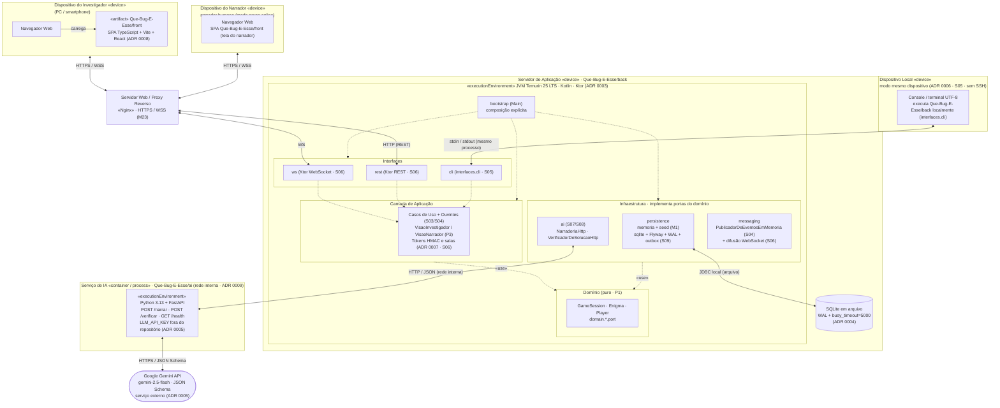

# Diagrama de implantação

| Campo | Valor |
|---|---|
| Fonte original | [`diagramas/Diagrama_imp.pdf`](../../diagramas/Diagrama_imp.pdf), versão de 14/10/2026 |
| Estado | Atualizado em 2026-11-24 com S00–S05 e ADRs 0001–0009 (M1 concluído; S06–S09 especificadas) |

## Notas atualizadas (P9)

- **Sem SSH em produção (S05 D1, M15):** o acesso via SSH do PDF original foi removido. A CLI (`interfaces.cli`) roda localmente no mesmo processo JVM para o modo "mesmo dispositivo" (ADR 0006 A) e validação local (M1).
- **Sem `NarradorHumano` (ADR 0002 A):** o narrador humano usa o navegador (`Que-Bug-E-Esse/front`) e envia respostas/julgamentos pela API REST/WebSocket (`ResponderPergunta` e `JulgarProposta`).
- **Banco local SQLite (ADR 0004 B):** o servidor de banco separado via TCP foi substituído por SQLite em arquivo no nó da aplicação com Flyway, modo WAL (`busy_timeout=5000`), bloqueio otimista `versao` e tabela `eventos_outbox` (S09). Em M1 e na CI padrão, seguem os repositórios em memória (P6).
- **Serviço stateless `Que-Bug-E-Esse/ai` e Gemini (ADR 0005 A, ADR 0009 A):** o `back` nunca fala diretamente com o provedor de LLM nem guarda `LLM_API_KEY`; o serviço `ai` isola prompts defensivos (M7), teto de 10.000 tokens/partida e saída estruturada do `gemini-2.5-flash`, acessível apenas na rede interna pelo `back`.
- **Front-end e acesso único pelo proxy (ADR 0008 A, M23):** a SPA `Que-Bug-E-Esse/front` (TypeScript + Vite + React) comunica-se exclusivamente com `Que-Bug-E-Esse/back` (via proxy HTTPS/WSS em produção ou direto ao Ktor em desenvolvimento), autenticando convidados com token HMAC-SHA256 (ADR 0007 A).
- **Mensageria (S04 D4):** em M1, `infrastructure.messaging` contém apenas `PublicadorDeEventosEmMemoria`; a difusão em tempo real para clientes conectados entra via Ktor WebSocket na S06.

Legenda: retângulo aninhado = nó «device» / ambiente de execução · linha cheia = comunicação (protocolo no rótulo) · tracejada = dependência.
