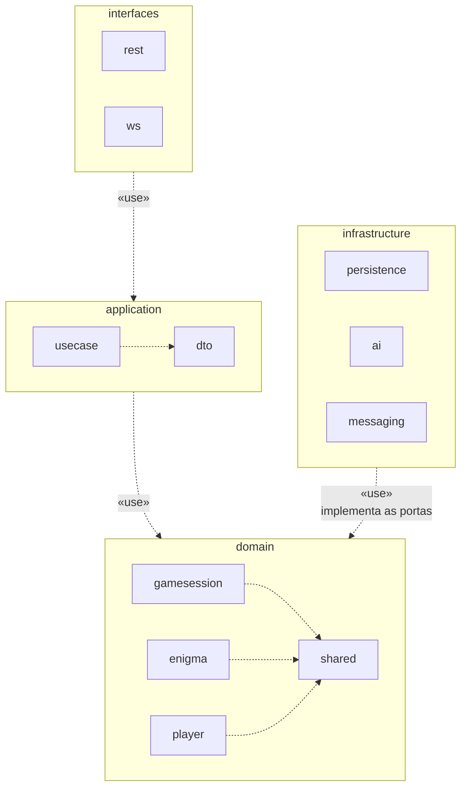

# Diagrama de pacotes

| Campo | Valor |
|---|---|
| Fonte original | [`diagramas/diagrama_pacotes.pdf`](../../diagramas/diagrama_pacotes.pdf), versão de 14/10/2026 |
| Estado | Transcrição fiel do PDF. As mudanças já decididas nas specs e ADRs estão em [Pendências por diagrama](README.md#pendências-por-diagrama) |

Raiz: `com.quebugesse`.

Legenda do PDF: pasta laranja = camada · pasta clara = pacote Kotlin · tracejada com seta aberta = dependência «use» · raiz: com.quebugesse.
