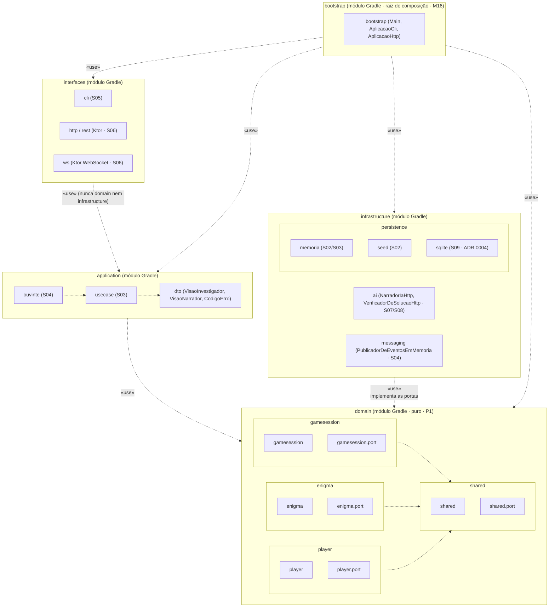

# Diagrama de pacotes

| Campo | Valor |
|---|---|
| Fonte original | [`diagramas/diagrama_pacotes.pdf`](../../diagramas/diagrama_pacotes.pdf), versão de 14/10/2026 |
| Estado | Atualizado em 2026-11-24 com S00–S05 (M1 concluído) e pacotes especificados para S06–S09 |

Raiz: `com.quebugesse` (módulos Gradle em `Que-Bug-E-Esse/back`).

## Notas atualizadas (P9)

- **Módulo `bootstrap` (S00 D1, S05 D4, M16):** quinto módulo Gradle, único que depende das quatro camadas e instancia adaptadores, seed, casos de uso, ouvintes e ponto de entrada (`Main`).
- **Portas por agregado (S02 D4, S03 D9, S04 D1):**
  - `domain.gamesession.port`: `GameSessionRepository`, `Narrador`, `VerificadorDeSolucao`
  - `domain.enigma.port`: `EnigmaRepository`, `GeradorDeEnigmas` (S11)
  - `domain.player.port`: `PlayerRepository`
  - `domain.shared.port`: `PublicadorDeEventos`, `OuvinteDeEvento`
- **Regras verificadas por Konsist em todo build (S00 D2, P1, P7):**
  - `domain` só importa `kotlin.*`, `java.time.*`, `java.util.UUID` e pacotes do próprio `domain` (proibidos `Instant.now()`, `Clock`, `UUID.randomUUID()` e `Random`).
  - `gamesession`, `enigma` e `player` dependem apenas de `shared`, nunca entre si.
  - `interfaces` depende exclusivamente de `application` (zero imports de `domain` ou `infrastructure`).
- **Pacotes de S02–S09:** `application.ouvinte` (S04 D6), `interfaces.cli` (S05 D2), `infrastructure.persistence.memoria` e `infrastructure.persistence.seed` (S02 D9), além de `infrastructure.persistence.sqlite` (S09), `infrastructure.ai` (S07/S08) e `interfaces.http`/`ws` (S06).

Legenda: caixa externa = módulo Gradle · subcaixa = pacote Kotlin sob `com.quebugesse` · seta tracejada = dependência `«use»`.
