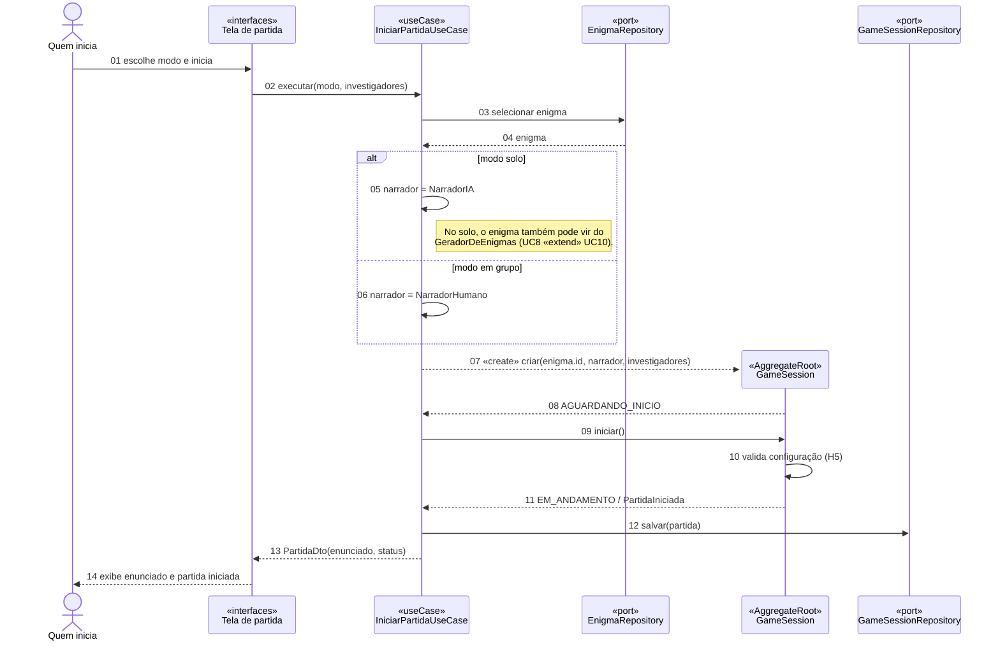

# Diagrama de sequência 1/2: iniciar partida

| Campo | Valor |
|---|---|
| Fonte original | [`diagramas/diagrama_seq_iniciar.pdf`](../../diagramas/diagrama_seq_iniciar.pdf), versão de 14/10/2026 |
| Estado | Transcrição fiel do PDF. As mudanças já decididas nas specs e ADRs estão em [Pendências por diagrama](README.md#pendências-por-diagrama) |

## Notas do PDF

- "A tela recebe só enunciado e estado público: solucaoCompleta nunca sai do domínio durante a investigação."
- "«Quem inicia» = narrador humano (modo em grupo) ou o próprio investigador (modo solo)."

Legenda do PDF: cabeçalho escuro = «AggregateRoot» · bege = «useCase» · laranja-claro = «port» · seta cheia = chamada · tracejada = retorno / «create» · quadro laranja = fragmento (alt).
