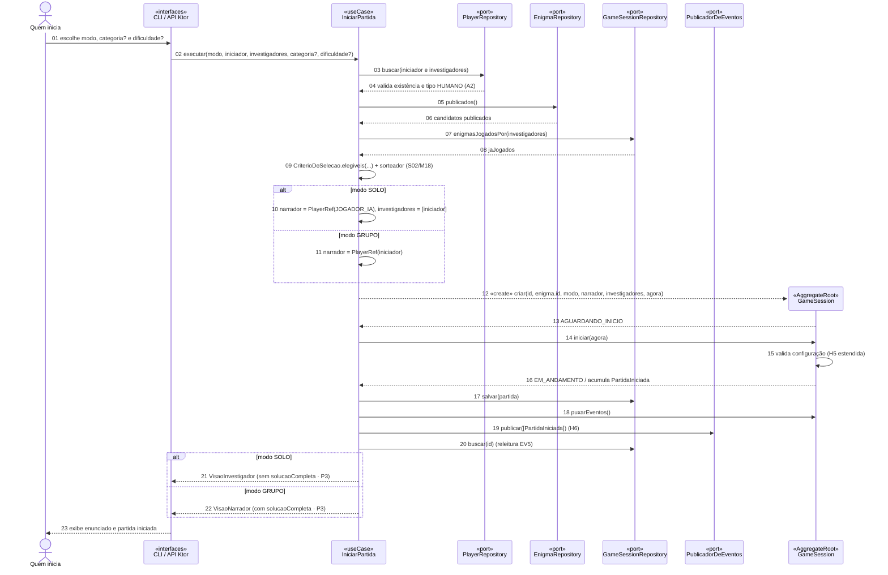

# Diagrama de sequência 1/2: iniciar partida

| Campo | Valor |
|---|---|
| Fonte original | [`diagramas/diagrama_seq_iniciar.pdf`](../../diagramas/diagrama_seq_iniciar.pdf), versão de 14/10/2026 |
| Estado | Atualizado em 2026-11-24 com S02, S03, S04 e ADRs 0001–0007 |

## Notas atualizadas (P9)

- **Sigilo por papel (P3, M1, S03 D4):** `VisaoInvestigador` nunca inclui `solucaoCompleta` antes de um estado terminal; `VisaoNarrador` inclui a solução apenas para o narrador autenticado da partida. Na CLI (S05), a tela compartilhada não exibe a solução automaticamente (exige comando `solucao` com confirmação).
- **Seleção de enigma (S02 D5, M18):** `EnigmaRepository` devolve `publicados()`; o domínio filtra com `CriterioDeSelecao` excluindo `jaJogados` (`GameSessionRepository.enigmasJogadosPor`); a aplicação sorteia via `Sorteador` (determinístico nos testes, P1).
- **Publicação após persistir e releitura (H6, EV5, S04 D7):** `PartidaIniciada` só é publicado após `salvar(partida)` retornar com sucesso; em seguida o caso de uso relê a partida antes de montar a visão de retorno.
- **Sala de espera no grupo online (M11, S06):** na API Ktor (S06), o modo `GRUPO` online separa `CriarPartida` (que cria a partida em `AGUARDANDO_INICIO` com código de sala para os investigadores entrarem via UC12) de `IniciarPartida` (passo 14 em diante). No modo `SOLO` e na CLI local (S05), criação e início ocorrem em sequência como acima.
- **"Quem inicia" (M12):** narrador humano no modo `GRUPO`, ou o próprio investigador no modo `SOLO`.

Legenda: cabeçalho escuro = «AggregateRoot» · bege = «useCase» · laranja-claro = «port» · seta cheia = chamada · tracejada = retorno / «create» · quadro = fragmento (`alt`).
