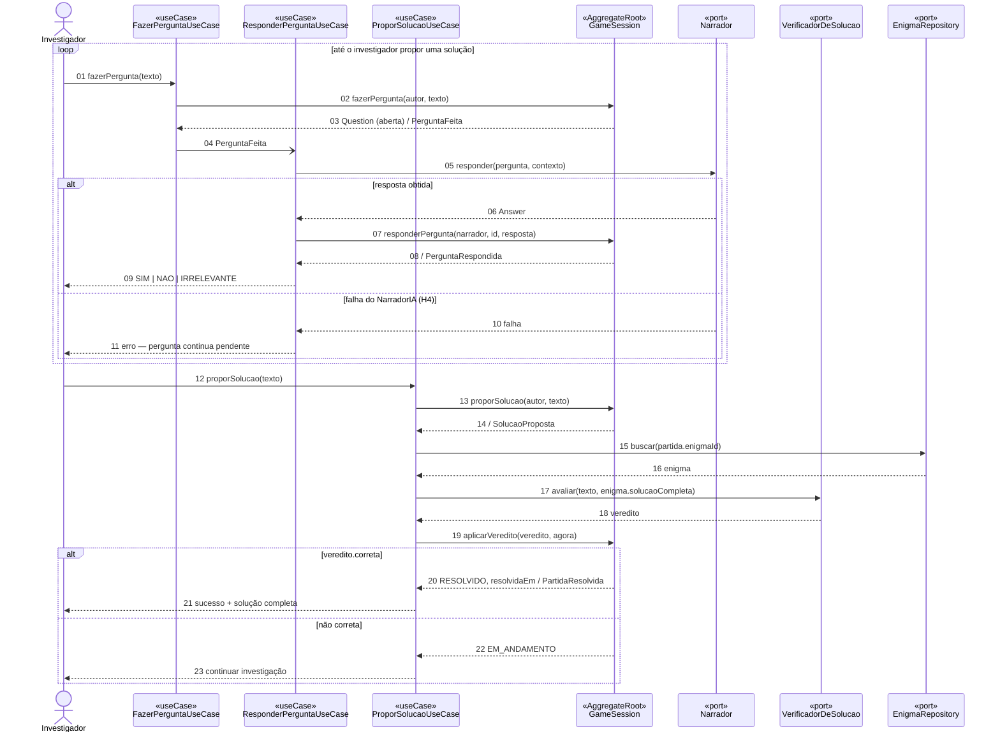

# Diagrama de sequência 2/2: investigar e resolver

| Campo | Valor |
|---|---|
| Fonte original | [`diagramas/diagrama_seq_jogar.pdf`](../../diagramas/diagrama_seq_jogar.pdf), versão de 14/10/2026 |
| Estado | Transcrição fiel do PDF. As mudanças já decididas nas specs e ADRs estão em [Pendências por diagrama](README.md#pendências-por-diagrama) |

## Notas do PDF

- "Leitura adotada: o evento PerguntaFeita dispara ResponderPerguntaUseCase, que consulta o port Narrador (humano ou IA). A validar com a equipe."
- "Camada interfaces omitida (só traduz entrada/saída). Cada caso de uso carrega a partida do GameSessionRepository e a salva ao final."
- "Seta aberta (04) = mensagem assíncrona: o evento de domínio."

Legenda do PDF: cabeçalho escuro = «AggregateRoot» · bege = «useCase» · laranja-claro = «port» · seta cheia = chamada · aberta = assíncrona · tracejada = retorno · quadro laranja = fragmento (loop / alt).
